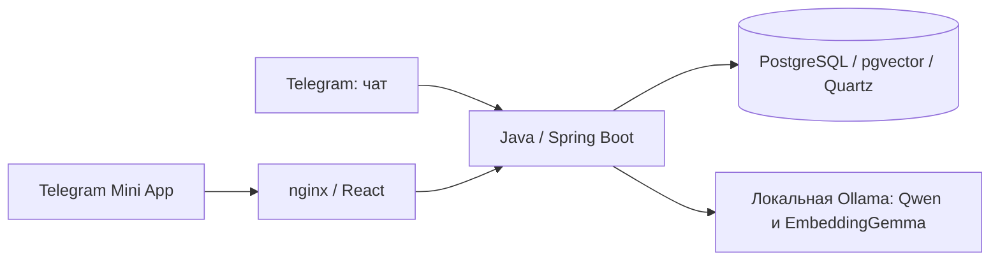

# Альфа-Курс — помощник предпринимателя

Решение второго трека хакатона Альфа-Банка: Telegram-бот и Mini App помогают
предпринимателю разобраться в бизнес-задаче, найти материалы «Альфа-Курса»,
сохранить план действий и получать напоминания.

**[Пошаговый запуск на Windows, macOS и Linux](docs/RUNBOOK.md)** — основной документ
для нового участника. Там описаны модели, приватные данные, Docker и подключение Mini App.

## Возможности

- Консультации по материалам курса с действительными ссылками и контекстом диалога.
- Профиль бизнеса: стадия, сфера, опыт, задача, налоговый режим и часовой пояс.
- План из 3–5 шагов с материалами, отметками выполнения и архивированием.
- Подтверждение сохранения и замены плана в чате; явное создание из Mini App.
- Разовые, ежедневные, еженедельные и ежемесячные напоминания.
- Редактирование, пауза, возобновление и отмена будущих отправок.
- Общие данные чата и трёх экранов Mini App: план, календарь и профиль.

В боте доступны `/start`, `/help`, `/profile`, `/plan`, `/reminders`.
Кнопка «Мой бизнес» открывает Mini App, когда настроен его публичный HTTPS-адрес.

## Как устроено



Java принимает события Telegram и HTTP-запросы, проверяет вход и принадлежность
данных, выполняет поиск, вызывает модели через Spring AI и сохраняет результат.
Quartz отправляет напоминания независимо от генерации ответа модели.

| Часть | Технологии |
|---|---|
| Бэкенд | Java 21, Spring Boot 4.1.2, Spring AI 2.0.2, Spring Security, Flyway |
| Интерфейс | React, TypeScript, Vite, Zustand, Tailwind, nginx |
| Хранение | PostgreSQL 17, pgvector, Quartz JDBC |
| Модели | `qwen3.5:9b-q4_K_M`, `embeddinggemma:300m`, локальная Ollama |
| Запуск | Docker Compose; Ollama работает на хосте |

Python-код ML-команды используется для подготовки данных и отдельных экспериментов.
Рабочий бот вызывает Ollama из Java; отдельный Python API или worker для его запуска не нужен.

## Перед первым запуском

Нужны Git, Docker с Compose v2, Ollama и две локальные модели. Для полноценной
работы получите у команды подготовленный пакет материалов либо исходный бэкап,
а в BotFather создайте своего бота и получите токен. Для Mini App нужен HTTPS.

**Банковский бэкап, корпус, веса моделей и токены в Git не включены.**
После одного клонирования можно поднять контейнеры и пустую БД; для консультаций
требуется отдельно импортировать разрешённые материалы. Порядок описан в инструкции.

```shell
git clone https://github.com/mkuzhvv/alfa-tg-botik.git
cd alfa-tg-botik
```

Скопируйте `env.example` в `.env`, установите модели и импортируйте корпус по
[инструкции](docs/RUNBOOK.md). После первичной настройки обычный запуск:

```shell
docker compose up -d --build --wait
```

| Адрес | Назначение |
|---|---|
| `http://localhost:8080/actuator/health` | Здоровье Java и подключения к БД |
| `http://localhost:8081` | Интерфейс; вход с данными пользователя — из Telegram |
| `localhost:5432` | Локальная PostgreSQL, пользователь `postgres`, без пароля |

Остановка с сохранением данных: `docker compose stop`. Повторный запуск:
`docker compose up -d --wait`. Не запускайте два экземпляра бота с одним токеном:
они будут конкурировать за события Telegram.

## Структура репозитория

| Путь | Содержимое |
|---|---|
| `backend/` | Java-приложение, миграции и тесты |
| `frontend/` | Telegram Mini App и браузерные проверки |
| `ml/` | Подготовка корпуса и ML-прототип RAG |
| `docs/` | Запуск, архитектура, ТЗ, API и форматы обмена |
| `dockerfiles/` | Dockerfile, nginx и инициализация исходной БД |
| `scripts/` | Восстановление бэкапа для PowerShell и Bash |
| `data/source/` | Локальные исходные файлы и журналы; исключены из Git |
| `data/processed/` | Локальные версии подготовленного корпуса; исключены из Git |

## Проверки и ограничения

Проверены вход, профиль, планы и напоминания через API, контейнер nginx и браузер.
В настоящем Telegram подтверждены консультации, сохранение действий, доставка
напоминания, открытие Mini App и синхронизация профиля с чатом в обе стороны.
Короткий итоговый прогон и его границы описаны в [инструкции](docs/RUNBOOK.md#проверка-перед-сдачей).

- Скорость Qwen зависит от RAM/VRAM и процессора. Общий бюджет модельного запроса — 60 секунд;
  слабое оборудование или холодная модель могут приводить к техническому ответу.
- Текущий Telegram polling обрабатывает события последовательно; долгий ответ модели
  задерживает следующие входящие команды. Планировщик напоминаний работает отдельно.
- Сессии Mini App хранятся в памяти. После перезапуска Java приложение нужно открыть заново.
- Бесплатный HTTPS-туннель временный: адрес меняется, его нужно обновлять в настройке бота.
- Java использует dense-поиск pgvector. Hybrid/BM25/RRF, извлечение точных выдержек
  и специальный калькулятор Python-прототипа в Java не перенесены.
- Приёмка качества на приватном наборе ML 1 и совместная оценка ответов с ML 2 остаются открытыми.
  Метрики Python-прототипа не являются метриками работающего Java-бота.
- После неопределённого ответа Telegram при отправке повтор не гарантирует отсутствие дубля;
  текущая реализация предпочитает не повторять отправку с неизвестным результатом.

## Документация

- [Первый запуск, повседневная работа и устранение проблем](docs/RUNBOOK.md).
- [ТЗ и указатель документов](docs/README.md), [архитектура](docs/ARCHITECTURE.md).
- [OpenAPI](docs/contracts/backend.openapi.yaml) и [правила API](docs/contracts/FRONTEND_API.md).
- [Формат поставки материалов](docs/contracts/data/README.md).
- [Разработка и проверки frontend](frontend/README.md).
- [ML-прототип](ml/README.md) и [его оценка](ml/EVALUATION.md).
- [История реализации и технические объяснения](docs/IMPLEMENTATION_NOTES.md).
